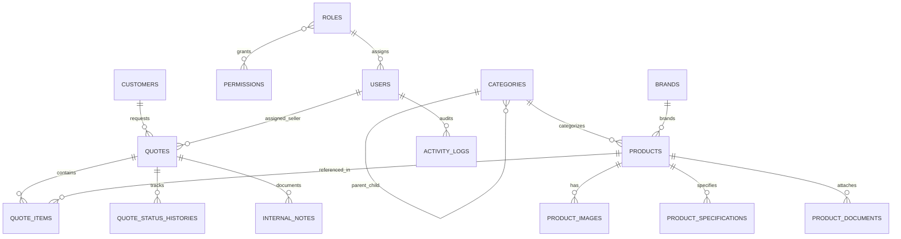

# Plan Maestro de Arquitectura e Ingeniería — Import Hns San Luis

> [!IMPORTANT]
> Este documento cumple con la **Sección 20 (Primera Acción Obligatoria)** y la **Fase 1 (Inspección y Planificación)** del Prompt Maestro, estableciendo la arquitectura verificada, el esquema de base de datos, las decisiones técnicas, las cuestiones comerciales pendientes y la orquestación multi-agente.

---

## 1. Resumen de Requisitos Confirmados

1. **Identidad y Mercado:** Plataforma comercial e industrial B2B/B2C para **Import Hns San Luis** (dominio previsto: `https://importhnssanluis.com`), enfocada en el mercado peruano (empresas, constructoras, carpinterías, profesionales y público general).
2. **Catálogo Técnico Escalable (+1,000 productos):**
   - SKU único, nombre, slug único, descripción breve y técnica, marca, categoría y subcategoría jerárquica, galería de imágenes, especificaciones técnicas dinámicas por producto/categoría, medidas, material, unidad de venta, archivo técnico PDF opcional, estado (`published`, `draft`, `archived`).
   - Búsqueda avanzada (nombre, SKU, marca, categoría, especificaciones) y filtros combinables con paginación del lado del servidor e índices SQL optimizados.
   - Importación y exportación masiva (CSV/Excel compatible) con vista previa de creación/actualización por SKU, validación estricta, procesamiento por lotes, registro de auditoría y descarga de reporte de errores.
3. **Precios y Disponibilidad Configurables:**
   - Configuración global y por producto: mostrar precio, ocultar precio ("Solicitar cotización") o modo mixto.
   - Estados de disponibilidad claros y reales: `available` (Disponible), `on_request` (Bajo consulta), `out_of_stock` (Sin stock, cuando aplique), `unknown` (Por confirmar). Nunca mostrar `S/ 0.00` como precio real.
4. **Motor de Cotizaciones (Individual y Carrito Múltiple):**
   - Flujo sin obligación de registro previo: selección de 1 o N productos con cantidades y observaciones, datos de contacto (Nombre, Correo, Teléfono, Empresa y RUC opcionales con validación de formato peruano de 11 dígitos cuando se ingresa), consentimiento de privacidad (Ley N° 29733), generación de código único de referencia (ej. `COT-2026-00001`).
   - Gestión administrativa completa: estados configurables (`nueva`, `en_revision`, `pendiente_info`, `en_preparacion`, `respondida`, `aceptada`, `rechazada`, `cerrada`), asignación de vendedor, notas internas, historial de cambios (`quote_status_histories`), registro de precios ofertados, generación de **PDF comercial de cotización** y envío de respuesta por correo con control de idempotencia.
5. **Integración WhatsApp Business y Correo Corporativo:**
   - Enlaces codificados para compartir fichas técnicas de productos e iniciar consultas con el resumen de cotización hacia el número comercial configurable.
   - Envío de correos transaccionales (confirmación al cliente, notificación al equipo, respuesta comercial con PDF) con plantillas HTML/texto y herramienta de diagnóstico SMTP en el panel.
6. **Panel Administrativo Completo (16 Módulos) y RBAC Real:**
   - Roles en servidor: `admin` (Administrador), `seller` (Vendedor), `catalog_editor` (Editor de catálogo), `supervisor` (Supervisor).
   - 16 módulos: Dashboard, Productos, Categorías, Marcas, Imágenes y archivos, Importación/Exportación, Solicitudes de cotización, Clientes/Contactos, Usuarios y permisos, Contenido de páginas, Configuración comercial, Configuración WhatsApp/Correo, SEO, Testimonios, Registro de actividad (`activity_logs`) e Informes básicos.
7. **SEO Técnico, Analítica (GA4) y Cumplimiento Legal Peruano:**
   - Sitemap XML dinámico, `robots.txt`, URLs canónicas, Open Graph, JSON-LD Schema.org (`Organization`, `WebSite`, `BreadcrumbList`, `Product`), eventos GA4 sin enviar PII, y páginas legales adaptadas a Perú (Ley N° 29733 — Ley de Protección de Datos Personales).

---

## 2. Comprobación del Entorno Disponible y Decisiones Técnicas

### 2.1 Auditoría del Entorno Local (`C:\laragon\www\sanluis`)
- **Sistema Operativo:** Windows (entorno Laragon).
- **PHP:** `PHP 8.3.30 (cli) x64` con `bcmath`, `curl`, `dom`, `exif`, `fileinfo`, `gd`, `intl`, `mbstring`, `mysqli`, `openssl`, `pdo_mysql`, `pdo_sqlite`, `sodium`, `xml`, `zip`, `zlib`, `Zend OPcache`.
- **Composer:** `2.9.4` (con auditoría de seguridad activa).
- **Base de Datos:** `MySQL 8.4.3` activo en `127.0.0.1:3306` (bases de datos `sanluis` y `sanluis_test` creadas en `utf8mb4_unicode_ci`) + soporte `SQLite` para pruebas aisladas si se requiere.
- **Node.js / NPM:** `Node v24.18.0` / `NPM 11.16.0`.
- **Git:** `2.47.1.windows.1`.

### 2.2 Decisiones Técnicas (ADR Resumen)
1. **Framework Backend:** **Laravel 13.x (`v13.37.0`)** sobre PHP 8.3.30. *Justificación:* Versiones anteriores (Laravel 11.x) presentan avisos de seguridad bloqueados por Composer 2.9.4 (`PKSA-*`), mientras que Laravel 13.37.0 es la versión estable actual sin vulnerabilidades reportadas (`No security vulnerability advisories found`), 100% compatible con PHP 8.3 y MySQL 8.4.
2. **Arquitectura Frontend:** **Laravel Blade + Componentes Reutilizables + Tailwind CSS + JavaScript moderno**. *Justificación:* Cumple con el principio de evitar SPAs complejas innecesarias, garantiza indexabilidad SEO nativa al 100%, tiempos de carga mínimos (Core Web Vitals) y facilidad de despliegue en cualquier hosting compatible con Laravel.
3. **Generación de PDF de Cotizaciones:** `dompdf/dompdf` integrado mediante `QuotePdfService` (con plantilla HTML/CSS dedicada e información comercial configurable).
4. **Control de Acceso (RBAC):** Implementación nativa en base de datos (`roles`, `permissions`, `role_user`, `permission_role`) con `Policies` de Laravel y middleware `EnsureUserHasRoleAndPermission`, evitando dependencias pesadas y garantizando control total y auditable en cada controlador y ruta.

---

## 3. Cuestiones Comerciales Pendientes (Con Configuración Provisional Segura)

Dado que el negocio aún debe confirmar ciertos datos corporativos definitivos antes de salir a producción, se implementan como **parámetros editables desde el Panel Administrativo (`site_settings` y `page_contents`)**:

1. **Política definitiva de precios públicos:** Provisionalmente configurada en modo `mixed` (muestra precio solo si el producto tiene `show_price = true` y un `price > 0`; en caso contrario muestra *"Solicitar cotización"*). Editable globalmente (`show_all`, `hide_all`, `mixed`) e individualmente.
2. **Datos societarios exactos:** RUC oficial, razón social exacta, dirección física de almacén/tienda y teléfonos fijos corporativos. Se dejan parametrizables en *Configuración Comercial* sin inventar certificaciones ni años de experiencia.
3. **Logotipo oficial en alta resolución:** Se implementa una identidad tipográfica industrial vectorial (SVG) limpia y sustituible desde el panel administrativo.
4. **Credenciales productivas de SMTP, WhatsApp oficial, GA4 (`G-XXXXXXXXXX`) y token de Google Search Console:** Se preparan mediante `.env` y el módulo de configuración administrativa (con herramienta de prueba de correo integrada).
5. **Testimonios y logotipos de clientes autorizados:** El módulo está completo en BD y panel, pero la sección pública se oculta automáticamente mientras no existan testimonios marcados como `is_verified = true` y `is_active = true`.

---

## 4. Estructura de Carpetas y Módulos

```text
C:\laragon\www\sanluis\
├── app/
│   ├── Enums/                  # Estados de cotización, disponibilidad, visibilidad de precios
│   ├── Http/
│   │   ├── Controllers/
│   │   │   ├── Public/         # Home, Catalog, ProductDetail, QuoteCart, Contact, Legal, Sitemap
│   │   │   ├── Auth/           # Login, Register, PasswordReset, Profile
│   │   │   └── Admin/          # Los 16 módulos del Panel Administrativo
│   │   ├── Middleware/         # CheckRole, CheckPermission, SecurityHeaders, TrackAnalytics
│   │   └── Requests/           # FormRequests con validaciones estrictas
│   ├── Mail/                   # QuoteReceivedCustomerMail, QuoteReceivedTeamMail, QuoteProposalMail
│   ├── Models/                 # Modelos Eloquent con relaciones e índices
│   ├── Policies/               # Políticas de autorización (Product, Quote, User, Settings, etc.)
│   └── Services/
│       ├── CatalogSearchService.php
│       ├── ProductImportExportService.php
│       ├── QuoteService.php
│       ├── QuotePdfService.php
│       ├── WhatsAppService.php
│       └── ActivityLoggerService.php
├── database/
│   ├── migrations/             # Esquema relacional completo con índices y FKs
│   └── seeders/                # Roles, permisos, configuración inicial y catálogo técnico demo claramente etiquetado
├── resources/
│   ├── views/
│   │   ├── components/         # Componentes Blade UI/UX reutilizables
│   │   ├── layouts/            # public.blade.php, admin.blade.php, auth.blade.php
│   │   ├── public/             # Vistas del portal público y catálogo
│   │   ├── admin/              # Vistas de los 16 módulos administrativos
│   │   ├── emails/             # Plantillas HTML y texto plano de correos
│   │   └── pdf/                # Plantilla de cotización formal en PDF
├── routes/
│   ├── web.php                 # Rutas públicas, carrito de cotización y autenticación
│   └── admin.php               # Rutas administrativas protegidas por RBAC
├── tests/
│   ├── Feature/                # Pruebas de Catálogo, Cotizaciones, Importación, Seguridad y RBAC
│   └── Unit/                   # Pruebas unitarias de servicios y cálculo
└── docs/                       # Documentación completa de arquitectura, operación y despliegue
```

---

## 5. Esquema Inicial de Base de Datos



### Entidades Principales:
1. `users`: `id`, `name`, `email` (unique), `phone`, `company`, `ruc`, `password`, `role_id` (FK), `is_active`, `last_login_at`, `timestamps`, `softDeletes`.
2. `roles` y `permissions` (`permission_role`): soporte para `admin`, `seller`, `catalog_editor`, `supervisor` y permisos modulares (`catalog.manage`, `quotes.view`, `quotes.manage`, `users.manage`, `settings.manage`, `reports.view`, etc.).
3. `categories`: `id`, `parent_id` (FK nullable), `name`, `slug` (unique), `description`, `image_path`, `attribute_schema` (JSON opcional de atributos sugeridos por categoría), `sort_order`, `is_active`, `meta_title`, `meta_description`, `timestamps`.
4. `brands`: `id`, `name`, `slug` (unique), `logo_path`, `website`, `is_verified`, `is_active`, `sort_order`, `timestamps`.
5. `products`: `id`, `sku` (unique, indexed), `name` (indexed), `slug` (unique), `short_description`, `detailed_description`, `brand_id` (FK nullable), `category_id` (FK), `subcategory_id` (FK nullable), `dimensions`, `material`, `sale_unit` (ej. Unidad, Caja, Metro, Par), `price` (decimal 12,2 nullable), `currency` (`PEN`, `USD`), `price_visibility` (`inherit`, `show`, `hide`), `availability_status` (`available`, `on_request`, `out_of_stock`, `unknown`), `technical_pdf_path`, `status` (`published`, `draft`, `archived`), `is_featured`, `views_count`, `meta_title`, `meta_description`, `timestamps`, `softDeletes`.
6. `product_images`: `id`, `product_id` (FK), `file_path`, `thumbnail_path`, `alt_text`, `is_primary`, `sort_order`, `timestamps`.
7. `product_specifications`: `id`, `product_id` (FK), `spec_group`, `spec_key` (indexed), `spec_value` (indexed), `unit`, `sort_order`, `timestamps`.
8. `product_documents`: `id`, `product_id` (FK), `title`, `file_path`, `file_size`, `mime_type`, `downloads_count`, `timestamps`.
9. `customers`: `id`, `user_id` (FK nullable), `name`, `email` (indexed), `phone`, `company`, `ruc` (indexed), `address`, `sector`, `is_authorized_contact`, `notes`, `timestamps`.
10. `quotes`: `id`, `reference_code` (unique, ej. `COT-2026-00001`), `customer_id` (FK nullable), `user_id` (FK nullable), `assigned_seller_id` (FK `users` nullable), `contact_name`, `contact_email`, `contact_phone`, `company_name`, `ruc`, `request_type` (`single`, `multiple`), `origin` (`web_catalog`, `product_detail`, `whatsapp`, `manual`), `status` (`nueva`, `en_revision`, `pendiente_info`, `en_preparacion`, `respondida`, `aceptada`, `rechazada`, `cerrada`), `currency`, `subtotal_offered`, `tax_offered`, `total_offered`, `customer_observations`, `commercial_response`, `validity_days`, `valid_until`, `privacy_accepted_at`, `responded_at`, `follow_up_date`, `last_email_idempotency_key`, `timestamps`, `softDeletes`.
11. `quote_items`: `id`, `quote_id` (FK), `product_id` (FK nullable), `sku_snapshot`, `product_name_snapshot`, `sale_unit_snapshot`, `quantity` (decimal 10,2), `unit_price_offered` (decimal 12,2 nullable), `subtotal_offered` (decimal 12,2 nullable), `item_notes`, `timestamps`.
12. `quote_status_histories`: `id`, `quote_id` (FK), `changed_by` (FK `users` nullable), `previous_status`, `new_status`, `comment`, `notified_customer`, `created_at`.
13. `internal_notes`: `id`, `quote_id` (FK), `user_id` (FK), `note`, `is_pinned`, `timestamps`.
14. `product_import_batches`: `id`, `user_id` (FK), `filename`, `status` (`preview`, `processing`, `completed`, `failed`), `total_rows`, `created_count`, `updated_count`, `rejected_count`, `preview_data` (JSON), `error_report` (JSON), `timestamps`.
15. `contact_messages`: `id`, `name`, `email`, `phone`, `company`, `ruc`, `subject`, `message`, `status`, `privacy_accepted_at`, `ip_address`, `timestamps`.
16. `testimonials`: `id`, `author_name`, `author_role`, `company_name`, `content`, `rating`, `is_verified`, `authorization_reference`, `is_active`, `sort_order`, `timestamps`.
17. `page_contents`: `id`, `page_key` (unique: `home`, `about`, `privacy_policy`, `cookies_policy`, `terms_conditions`, `quote_conditions`), `title`, `subtitle`, `content` (longText), `sections_json` (JSON), `meta_title`, `meta_description`, `is_indexable`, `updated_by`, `timestamps`.
18. `site_settings`: `id`, `setting_group` (`commercial`, `contact`, `whatsapp`, `mail`, `seo`, `analytics`), `setting_key` (unique), `setting_value`, `setting_type`, `is_public`, `timestamps`.
19. `activity_logs`: `id`, `user_id` (FK nullable), `action`, `module`, `subject_type`, `subject_id`, `description`, `properties` (JSON — nunca almacena contraseñas ni secretos), `ip_address`, `user_agent`, `created_at`.

---

## 6. Flujos Principales del Usuario y del Administrador

### Flujo Público de Búsqueda y Cotización
1. El visitante explora el catálogo mediante el buscador técnico (SKU, nombre, marca, especificación) o filtros combinables (categoría, subcategoría, marca, disponibilidad, especificaciones).
2. En la ficha de producto o listado, puede:
   - **Cotizar individualmente (1 clic):** Abre el formulario pre-cargado con ese producto.
   - **Añadir a lista de cotización (Carrito B2B):** Agrega múltiples ítems con sus cantidades y observaciones por ítem.
   - **Consultar por WhatsApp:** Abre WhatsApp con un mensaje codificado con SKU, nombre y enlace canónico.
3. En `/solicitar-cotizacion`, revisa su lista, ajusta cantidades, ingresa sus datos de contacto (y RUC/Empresa opcionales), acepta la Política de Privacidad y envía la solicitud.
4. El sistema registra la cotización en una transacción DB, genera el código `COT-YYYY-NNNNN`, despacha los correos de confirmación y muestra la pantalla de confirmación con opción de enviar el resumen por WhatsApp.

### Flujo Administrativo de Atención y Catálogo
1. El **Editor de Catálogo** o **Administrador** gestiona productos manualmente o mediante el **Importador CSV**: sube el archivo, revisa la **Vista Previa** (qué SKUs se crearán, cuáles se actualizarán y cuáles tienen errores de validación), confirma la ejecución por lotes y descarga el reporte de errores si aplica.
2. El **Vendedor** o **Administrador** recibe la cotización en estado `nueva`, la toma o se le asigna un responsable, cambia el estado a `en_revision` / `en_preparacion`, añade notas internas, registra los precios unitarios ofertados y condiciones de vigencia, previsualiza el **PDF comercial** y envía la propuesta formal al cliente (cambiando a `respondida`, con clave de idempotencia para evitar envíos duplicados).

---

## 7. Riesgos de Seguridad, Integración y Despliegue

1. **Seguridad de Archivos Subidos:** Validación estricta de MIME types reales (`image/jpeg`, `image/png`, `image/webp` para fotos; `application/pdf` para fichas técnicas), límites de tamaño y nombres sanitizados.
2. **Protección de Datos Personales (Ley N° 29733 Perú):** Minimización de datos, consentimiento explícito con timestamp (`privacy_accepted_at`), exclusión total de PII en eventos de Google Analytics 4 y ocultación de credenciales en logs y herramientas de diagnóstico.
3. **Abuso de Formularios y Fuerza Bruta:** Rate limiting específico en login, solicitud de cotización y formulario de contacto, combinado con campo *honeypot* antispam y tokens CSRF.
4. **Riesgo de Sobrescritura en Importación:** Mitigado mediante flujo obligatorio de 2 pasos (1: Análisis y Vista Previa; 2: Confirmación explícita con transacción por lotes).

---

## 8. Orquestación Multi-Agente y Plan de Tareas por Dependencias

El agente principal (**Arquitecto y Orquestador**) coordina a los 5 subagentes especializados en el siguiente orden de fases:

- **Fase 1 y 2 (`ui-ux-seo-specialist` + Orquestador):** Análisis de referencias peruanas (`martin.com.pe`, `carpintec.com.pe`, `promart.pe`), sistema de diseño industrial Tailwind CSS, arquitectura Laravel 12 y base de datos MySQL 8.4.
- **Fase 3 (`backend-db-engineer`):** Implementación de las 19 tablas/migraciones, modelos Eloquent, RBAC (Roles, Permisos, Policies, Middlewares), Servicios de Catálogo, Cotizaciones, PDF, Importación/Exportación, WhatsApp, Correo y Seeders iniciales.
- **Fase 4A (`frontend-public-engineer`):** Implementación del portal público completo (Layout responsive accesible, Inicio, Nosotros, Catálogo con filtros combinables, Detalle de producto, Carrito/Formulario de Cotización, Contacto, Clientes/Testimonios, Autenticación y Páginas Legales).
- **Fase 4B (`admin-backoffice-engineer`):** Implementación de los 16 módulos del Panel Administrativo con control de permisos en servidor.
- **Fase 4C (`ui-ux-seo-specialist`):** Integración final de SEO técnico (Sitemap XML, `robots.txt`, Schema.org JSON-LD, Open Graph, Canonicals) y capa de eventos GA4 sin PII.
- **Fase 5 y 6 (`qa-devops-engineer` + Orquestador):** Batería de pruebas automatizadas PHPUnit (Catálogo, Cotizaciones, Importación, Seguridad RBAC, Interfaz), auditoría de rendimiento SQL y entrega de toda la documentación técnica, comercial y de despliegue.
