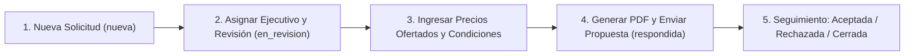

# Guía de Administración y Manual de Importación del Catálogo — Import Hns San Luis

> [!NOTE]
> Este manual está dirigido al personal comercial, de catálogo, supervisión y administración general de **Import Hns San Luis**. Describe el funcionamiento operativo de los **16 módulos del Panel Administrativo (`/admin`)**, la matriz de permisos por rol (RBAC), la gestión de cotizaciones y el procedimiento completo de importación y exportación masiva del catálogo en formato CSV.

---

## 1. Acceso al Panel Administrativo y Matriz de Roles (RBAC)

El acceso al panel administrativo se realiza desde `/login`. Al iniciar sesión con una cuenta de personal interno activa, el sistema redirige automáticamente a `/admin`.
Todas las rutas y acciones están protegidas en el servidor según el principio de **mínimo privilegio**:

| Módulo / Permiso | Administrador (`admin`) | Vendedor (`seller`) | Editor de Catálogo (`catalog_editor`) | Supervisor (`supervisor`) |
| :--- | :---: | :---: | :---: | :---: |
| **1. Dashboard (`/admin`)** | Completo | Completo | Completo | Completo |
| **2. Productos (`/admin/productos`)** | Crear / Editar / Archivar | Solo lectura | Crear / Editar / Archivar | Solo lectura |
| **3. Categorías y Subcategorías (`/admin/categorias`)** | Completo | Sin acceso (`403`) | Completo | Sin acceso (`403`) |
| **4. Marcas (`/admin/marcas`)** | Completo | Sin acceso (`403`) | Completo | Sin acceso (`403`) |
| **5. Imágenes y Fichas PDF (`/admin/archivos`)** | Completo | Sin acceso (`403`) | Completo | Sin acceso (`403`) |
| **6. Importación y Exportación CSV (`/admin/importacion`)** | Completo | Sin acceso (`403`) | Completo | Sin acceso (`403`) |
| **7. Solicitudes de Cotización (`/admin/cotizaciones`)** | Ver / Gestionar / Responder | Ver / Gestionar / Responder | Sin acceso (`403`) | Solo lectura y PDF |
| **8. Clientes y Contactos B2B (`/admin/clientes`)** | Completo | Completo | Sin acceso (`403`) | Sin acceso (`403`) |
| **9. Usuarios y Permisos RBAC (`/admin/usuarios`)** | Completo | Sin acceso (`403`) | Sin acceso (`403`) | Sin acceso (`403`) |
| **10. Contenido de Páginas (`/admin/paginas`)** | Completo | Sin acceso (`403`) | Sin acceso (`403`) | Sin acceso (`403`) |
| **11. Configuración Comercial (`/admin/configuracion-comercial`)** | Completo | Sin acceso (`403`) | Sin acceso (`403`) | Sin acceso (`403`) |
| **12. WhatsApp y Correo SMTP (`/admin/comunicaciones`)** | Completo | Sin acceso (`403`) | Sin acceso (`403`) | Sin acceso (`403`) |
| **13. SEO y Analítica GA4 (`/admin/seo`)** | Completo | Sin acceso (`403`) | Sin acceso (`403`) | Sin acceso (`403`) |
| **14. Testimonios Verificados (`/admin/testimonios`)** | Completo | Sin acceso (`403`) | Sin acceso (`403`) | Sin acceso (`403`) |
| **15. Registro de Actividad (`/admin/actividad`)** | Solo lectura (Inmutable) | Sin acceso (`403`) | Sin acceso (`403`) | Solo lectura (Inmutable) |
| **16. Informes Comerciales (`/admin/informes`)** | Ver y Exportar CSV | Sin acceso (`403`) | Sin acceso (`403`) | Ver y Exportar CSV |

---

## 2. Operación de los 16 Módulos Administrativos

### Módulo 1: Dashboard (`/admin`)
- Muestra indicadores clave en tiempo real: productos publicados, productos bajo consulta, total de cotizaciones recibidas, cotizaciones pendientes de atención, cotizaciones del día, clientes registrados y lotes de importación ejecutados.
- Incluye tabla de últimas cotizaciones ingresadas, ranking de productos más cotizados y bitácora reciente de actividad.

### Módulo 2: Productos (`/admin/productos`)
- **Listado y Filtros:** Permite buscar por código SKU, nombre, material o medidas, y filtrar por categoría, marca, estado de disponibilidad, estado de publicación (`Publicado`, `Borrador`, `Archivado`) o papelera.
- **Creación y Edición:**
  - **Código SKU:** Único en todo el catálogo (ej. `SL-BIS-35SC-IN`). Se normaliza automáticamente a mayúsculas.
  - **Clasificación:** Categoría principal obligatoria, subcategoría opcional y marca opcional.
  - **Atributos Técnicos:** Dimensiones/medidas, material de fabricación, unidad de venta (`Unidad`, `Par`, `Juego`, `Caja x 100`, `Millar`, etc.) y tabla dinámica de **Especificaciones Técnicas** (`Grupo`, `Atributo`, `Valor`, `Unidad`).
  - **Archivos Multimedia:** Imagen principal, galería secundaria (`JPG`, `PNG`, `WEBP` hasta 4 MB) y Ficha Técnica en `PDF` (hasta 10 MB).
- **Archivado y Restauración:** Al eliminar un producto, este no se destruye físicamente para no romper cotizaciones históricas: cambia a estado `archived` y pasa a la papelera (*Soft Delete*), desde donde puede restaurarse en cualquier momento.

### Módulo 3: Categorías y Subcategorías (`/admin/categorias`)
- Soporta jerarquía de dos niveles: **Categoría Principal** (`parent_id = null`) y **Subcategorías** asociadas.
- Permite definir orden de visualización (`sort_order`), estado activo/inactivo y metadatos SEO propios (`meta_title`, `meta_description`).
- **Protección de Integridad:** No permite eliminar una categoría que tenga productos vinculados o subcategorías hijas activas.

### Módulo 4: Marcas (`/admin/marcas`)
- Gestión de marcas representadas o distribuidas.
- Cuenta con el indicador **`is_verified` (Marca Verificada / Autorizada)**: únicamente las marcas con `is_verified = true` e `is_active = true` se exhiben en el bloque institucional de marcas de la portada y de `/nosotros`.

### Módulo 5: Imágenes y Archivos (`/admin/archivos`)
- Gestor centralizado para inspeccionar, subir o desvincular fotografías de productos y fichas técnicas en formato PDF filtrando por código SKU.

### Módulo 6: Importación y Exportación Masiva (`/admin/importacion`)
- Permite descargar la plantilla oficial CSV, exportar el catálogo actual con filtros y ejecutar cargas masivas con validación previa (ver Sección 5 de este manual).

### Módulo 7: Solicitudes de Cotización (`/admin/cotizaciones`)
- Bandeja operativa de todas las solicitudes enviadas desde el portal público (tanto individuales como de carrito múltiple).
- Permite filtrar por rango de fechas, estado, vendedor asignado o buscar por código `COT-YYYY-NNNNN`, RUC, razón social, nombre o correo.
- Incluye botón de **Exportar a CSV** con el resumen comercial de las cotizaciones filtradas.

### Módulo 8: Clientes y Contactos B2B (`/admin/clientes`)
- Directorio de clientes corporativos y particulares consolidado automáticamente a partir de las cotizaciones o creado manualmente por los vendedores (razón social, RUC de 11 dígitos, sector, dirección, teléfono y notas comerciales).

### Módulo 9: Usuarios y Permisos (`/admin/usuarios`)
- Creación, edición, activación/desactivación y asignación de rol (`admin`, `seller`, `catalog_editor`, `supervisor`) para el personal interno.
- **Protección de Seguridad:** El sistema impide que un administrador desactive o elimine su propia cuenta en sesión.

### Módulo 10: Contenido de Páginas (`/admin/paginas`)
- Editor de contenido para las páginas institucionales (`Inicio`, `Nosotros`) y las 4 páginas legales (`Política de Privacidad`, `Política de Cookies`, `Términos y Condiciones`, `Condiciones de Cotización`), registrando qué usuario realizó la última actualización.

### Módulo 11: Configuración Comercial (`/admin/configuracion-comercial`)
- Control central de la política de visualización de precios, moneda predeterminada, porcentaje de IGV (18%), días de vigencia de las cotizaciones, datos societarios de la empresa (Nombre Comercial, Razón Social, RUC, dirección, horarios) y condiciones generales impresas en los PDFs de cotización.

### Módulo 12: Comunicaciones — WhatsApp y Correo (`/admin/comunicaciones`)
- Configuración del número oficial de **WhatsApp Business** (con código de país `51`), activación del botón flotante, mensaje predeterminado y correo receptor de alertas de ventas.
- Incluye el **Probador de Correo SMTP en Tiempo Real**: permite ingresar un correo de destino y disparar un mensaje de diagnóstico (`SmtpTestMail`) para verificar la conectividad del servidor de correo sin salir del panel.

### Módulo 13: SEO y Analítica Web (`/admin/seo`)
- Administración del título y descripción SEO predeterminados, directiva de indexación global, código de verificación de **Google Search Console** y activación de **Google Analytics 4** (`G-XXXXXXXXXX`).

### Módulo 14: Testimonios (`/admin/testimonios`)
- Registro de referencias comerciales de clientes con el campo obligatorio de control interno (`is_verified` y referencia de autorización).
- **Regla de Veracidad Comercial:** La página pública `/clientes-y-testimonios` y la portada solo muestran testimonios que tengan simultáneamente `is_verified = true` e `is_active = true`.

### Módulo 15: Registro de Actividad (`/admin/actividad`)
- Bitácora de auditoría inmutable (*solo lectura*) que registra inicios de sesión, cambios en productos, importaciones, cambios de estado de cotizaciones, envíos de propuestas y modificaciones de configuración, con dirección IP, fecha exacta y usuario actor.

### Módulo 16: Informes Comerciales (`/admin/informes`)
- Reportes gerenciales por rango de fechas: tasa de respuesta comercial, monto total ofertado, distribución de cotizaciones por estado, desempeño por ejecutivo comercial y ranking de los 15 productos más cotizados (con descarga en CSV).

---

## 3. Gestión de Precios y Disponibilidad (Global e Individual)

Import Hns San Luis puede operar con precios públicos, precios ocultos ("Solicitar cotización") o un esquema mixto:

1. **Modo Global (en `/admin/configuracion-comercial`):**
   - `mixed` (**Modo Mixto — Recomendado**): Muestra el precio en los productos cuya visibilidad individual sea `show` o `inherit` (siempre que tengan precio mayor a `0`), y oculta el precio en los productos configurados como `hide`.
   - `hide_all` (**Ocultar Todos los Precios**): Oculta todos los precios en el catálogo público sin borrar los montos guardados en la base de datos. Todos los productos muestran el botón *"Solicitar cotización"*.
   - `show_all` (**Mostrar Precios Disponibles**): Muestra los precios de todos los productos con monto mayor a `0`, salvo aquellos que tengan la excepción explícita `hide`.
2. **Regla de Seguridad contra Precios Falsos:**
   - Si un producto tiene precio vacío (`null`) o `0.00`, el sistema **jamás** muestra `S/ 0.00` en la web ni en los datos estructurados JSON-LD de Google; automáticamente presenta el producto en modalidad de cotización.

---

## 4. Flujo de Atención de Cotizaciones y Envío de Propuesta en PDF



1. **Recepción:** Cuando un cliente envía una solicitud en `/cotizacion`, se genera el código `COT-YYYY-NNNNN` en estado `nueva`.
2. **Asignación y Notas Internas:** En `/admin/cotizaciones/{id}`, el administrador o vendedor asigna el ejecutivo responsable, define la fecha de seguimiento y añade notas internas privadas.
3. **Elaboración de Propuesta Comercial y Envío por Correo:**
   - En el bloque **"Responder y Enviar Propuesta Comercial"**, el vendedor ingresa el **Precio Unitario Ofertado** para cada ítem de la solicitud.
   - El sistema calcula automáticamente el subtotal por línea, el IGV (18% opcional) y el total ofertado.
   - Al pulsar **"Guardar y Enviar Propuesta en PDF por Correo"**, el sistema:
     1. Actualiza los precios ofertados y las condiciones comerciales de la cotización.
     2. Genera el documento formal `Cotizacion-COT-YYYY-NNNNN.pdf` con membrete corporativo, tabla de códigos SKU, cantidades, precios unitarios y totales.
     3. Envía el correo `QuoteProposalMail` al cliente con el PDF adjunto.
     4. Cambia el estado a `respondida`, registra la trazabilidad en el historial de estados y guarda una clave de idempotencia (`last_email_idempotency_key`) para evitar envíos duplicados si el vendedor hace doble clic.
4. **Descarga Directa para WhatsApp:** En cualquier momento, el vendedor puede hacer clic en **"Descargar PDF"** o **"Contactar por WhatsApp"** desde el detalle de la cotización para compartir la propuesta directamente con el cliente.

---

## 5. Guía Detallada de Importación y Exportación del Catálogo (CSV)

El módulo `/admin/importacion` permite cargar o actualizar cientos o miles de productos desde hojas de cálculo (Excel / Google Sheets / ERP) guardadas como **CSV UTF-8**.

### 5.1 Flujo Seguro en 2 Pasos (Sin Sobrescritura Silenciosa)
1. **Paso 1 — Análisis y Vista Previa (`/admin/importacion/analizar`):**
   - El sistema lee el archivo CSV (acepta delimitador coma `,` o punto y coma `;` de Excel en español, y limpia automáticamente el encabezado BOM UTF-8).
   - Valida cada fila sin modificar aún la base de datos.
   - Clasifica cada fila válida como **`CREAR` (SKU nuevo)** o **`ACTUALIZAR` (SKU ya existente en el catálogo)**, y separa las filas con errores de validación.
2. **Paso 2 — Confirmación y Ejecución (`/admin/importacion/{lote}/ejecutar`):**
   - El operador revisa el resumen en pantalla.
   - Si existen filas rechazadas, puede descargar el archivo **`errores-importacion-lote-N.csv`** con el número de fila exacto y el motivo del rechazo.
   - Al confirmar la ejecución, las filas válidas se procesan dentro de una transacción de base de datos en bloques de 100 registros.

### 5.2 Columnas Soportadas en el Archivo CSV

Las 3 primeras columnas (`sku`, `name`, `category`) son **obligatorias**. El orden recomendado en la plantilla oficial (`plantilla-importacion-sanluis.csv`) es:

| Columna CSV | Obligatoria | Valores Permitidos / Formato | Ejemplo |
| :--- | :---: | :--- | :--- |
| `sku` | **Sí** | Texto único hasta 64 caracteres (sin duplicados en el mismo CSV). | `SL-BIS-35SC-IN` |
| `name` | **Sí** | Nombre técnico descriptivo del producto. | `Bisagra Cazoleta 35mm Cierre Suave Acero Inox` |
| `category` | **Sí** | Nombre de la categoría principal (si no existe, se crea activa). | `Herrajes y Accesorios para Muebles` |
| `subcategory` | No | Nombre de la subcategoría hija (si no existe, se crea bajo la categoría). | `Bisagras Cazoleta y Ocultas` |
| `brand` | No | Nombre de la marca (si no existe, se crea automáticamente). | `Ducasse Industrial` |
| `short_description` | No | Resumen técnico breve para tarjetas y listados. | `Bisagra cazoleta 35mm clip-on amortiguada.` |
| `detailed_description` | No | Descripción técnica extendida y aplicaciones recomendadas. | `Ideal para puertas de mobiliario de cocina...` |
| `dimensions` | No | Medidas principales o calibre. | `35mm / Apertura 110°` |
| `material` | No | Material base y acabado superficial. | `Acero Inoxidable SUS304` |
| `sale_unit` | No | Unidad de despacho (por defecto `Unidad`). | `Par`, `Juego`, `Unidad`, `Caja x 100` |
| `price` | No | Número positivo con punto decimal (dejar vacío si es bajo cotización). | `14.50` |
| `currency` | No | `PEN`, `USD` o `EUR` (por defecto `PEN`). | `PEN` |
| `price_visibility` | No | `inherit`, `show` o `hide` (por defecto `inherit`). | `inherit` |
| `availability_status` | No | `available`, `on_request`, `out_of_stock` o `unknown`. | `available` |
| `status` | No | `published`, `draft` o `archived` (por defecto `published`). | `published` |
| `specs` | No | Especificaciones dinámicas separadas por `\|` en formato `Clave:Valor`. | `Diámetro Cazoleta:35 mm\|Apertura:110°\|Ciclos:80,000` |

### 5.3 Formato de la Columna `specs` (Especificaciones Técnicas Dinámicas)
Para importar múltiples especificaciones técnicas en una sola celda del CSV, utiliza el formato `Atributo:Valor` separado por barra vertical (`|`):

```text
Diámetro Cazoleta:35 mm|Ángulo de Apertura:110°|Cierre:Suave Hidráulico|Ciclos de Apertura:80,000 ciclos
```

El importador dividirá automáticamente cada par y creará los registros estructurados en la tabla `product_specifications`, haciéndolos buscables y filtrables en el catálogo público.
